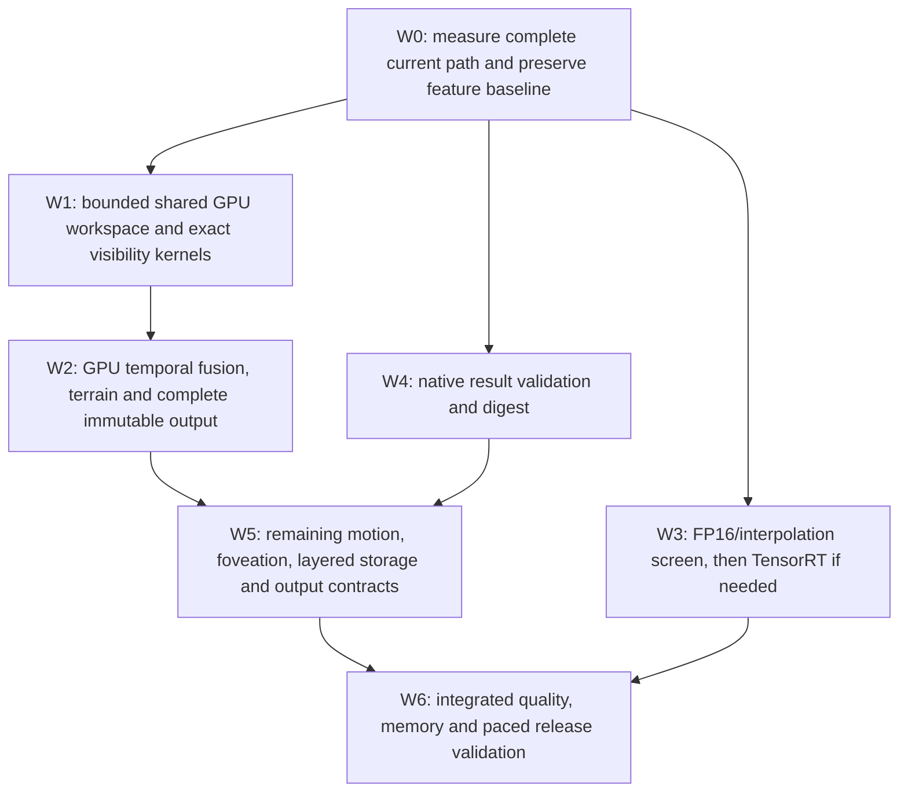

# Feature-preserving sub-100 ms implementation workflow

Date: 2026-10-22. Owner requested this workflow and authorized starting work
after [research 0053](research/experiments/0053-sub100ms-pragyaam-review.md).
Status: IN PROGRESS. The latency targets are engineering goals, not results.

## Features carried through every optimization

| Capability | Current state | Required preservation / remaining delivery |
| --- | --- | --- |
| Drivable / non-drivable terrain | Diagnostic temporal layer implemented | Retain DRIVABLE, NON_DRIVABLE, OBSTACLE, UNKNOWN and STALE; never make unknown drivable. Include fused arrays in the eventual complete receipt. |
| Ground and height | Implemented | Preserve ground validity, height, descriptive spread and obstacle envelopes. |
| Curbs, drops, overhangs | Diagnostic flags implemented | Preserve flags and their provenance; independent quality remains open. Pothole and slope acceptance are not already proved. |
| Semantics and obstacle candidates | Implemented bounded slices | Original-point alignment, all accepted points, learning IDs and candidate support retained. Measure quality for precision/model changes. |
| Visibility / occupancy | Current-scan beam evidence and diagnostic fusion implemented | Preserve beam proofs, counts, conflict rules, occupied/free/unknown/stale behavior, expiry and ghost-clearing safeguards. |
| Tracking / motion | Association implemented; velocity unknown | Preserve association. Motion estimation stays scheduled; no oracle motion enters production. |
| Adaptive foveation / layered store | Draft policies; fixed rolling diagnostic map exists | Keep these in final scope. Exact ownership/merge/split rules and resource limits precede adoption. |
| Dashboard / memory comparison | Diagnostic layers exist; full acceptance open | Keep terrain, occupancy and height views. Viewer has a separate display budget; compute/output needed by the consumer stays inside 100 ms. |

These are evidence outputs, not certified navigation-safe classifications.
The optimization target includes all enabled current stages. Final acceptance
must include all newly delivered required stages too, not just this baseline.

## Execution order



| Work | Deliverable and pass condition | Status |
| --- | --- | --- |
| W0 | Repeatable fresh-process source screen with hardware/power observations, all current stages and explicit terrain/visibility/tracking presence. Compare FP32, FP16 and GPU interpolation, with a repeated reference to expose drift. A short screen selects candidates; follow with controlled 200-frame traces. | IN PROGRESS |
| W1 | Internal point/ID/key/evidence workspace with bounded buffers and owned lifetimes. Fused visibility preserves exact samples, counts and proofs; compare complete arrays against reference before adoption. | TODO |
| W2 | Persistent GPU fusion/terrain work including neighbours, expiry, ownership movement and slot reuse. Compare all `FusedMapView` fields on sequential fixtures and real replay; measure publication cost. | IN PROGRESS: CUDA neighbours integrated; fixture and six real full-view byte parity checks pass (0055). Host fusion/publication remain. |
| W3 | Existing 2x2 precision/interpolation options first. TensorRT preprocessing/network split if insufficient. Pin checkpoint, projection, original-point mapping and quality evaluation; no default precision change solely from speed. | IN PROGRESS (screen) |
| W4 | Compile/vectorize receipt checks and exact current digest. If layout must change, prepare versioned contiguous result/proof contract with exhaustive rejection behavior. | TODO |
| W5 | Complete fused result, motion, adaptive foveation, exact layered-store behavior and final dashboard/resource evidence. Freeze concrete policies before implementation; retain all feature requirements above. | TODO |
| W6 | All required stages enabled; full ordered 08/00 and sequence 10 frame 206. Zero valid-scan drops/rejections/late receipts, first selected scan counted; approved quality/resource gates and immutable complete receipt. | TODO |

No stage can be omitted to make the timing pass. Kernel tests are exact-output
gates; changed model numerics require quality scoring. Future required features
must fit the budget or cause it to be revised. Release remains unverified until
W6 passes. Research and exact internal optimizations proceed under existing
authorization; numeric quality gates are not silently chosen by this workflow.

## Budget and experiment discipline

Initial serial target from research 0053: input/transfer/projection 5 ms;
FRNet 40; ground 15; mapping/candidates/association 8; visibility 10;
temporal/terrain/output 7; validation/digest 5. Total 90 ms, 10 ms margin.
These are unmeasured targets, including drivability computation. Additional
motion/foveation work must be included in the same 100 ms accounting.

Use one sequence engine per run and a fresh output directory. Keep AC-power,
driver, GPU clocks/temperature/power/memory and host memory observations with
the evidence. Do not change power settings automatically. Report cold, warm,
max and schedule age separately; do not sum independent stage medians.
The benchmark observer's overhead is part of its conditions. No benchmark may
label matching summaries as full-array parity or numeric class agreement as
held-out quality. Keep rejected and failed runs.

First executable screen:

```text
cd Drishti-2.5
.venv/Scripts/python.exe ../docs/research/experiments/0054-feature-preserving-screen.py <new-output> --frames 12
```

The screen drives the actual learned CLI, writes predictions, retains temporal
terrain summaries and every receipt, and returns a report rather than a false
release pass. Runtime output and defaults are unchanged by the harness.
